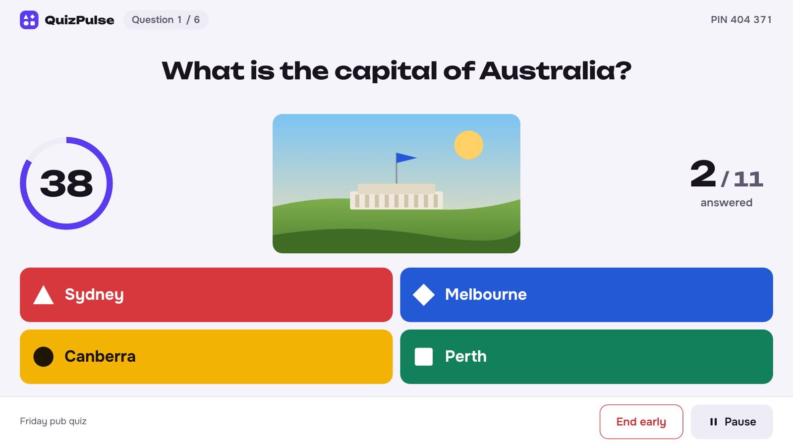
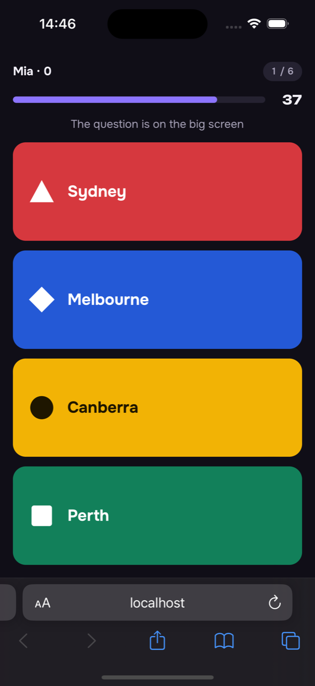
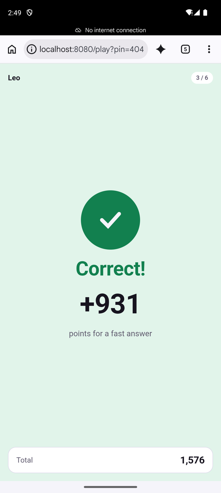

# QuizPulse

QuizPulse is a live-quiz platform for pub quizzes, board-game nights and team events, in the spirit of Kahoot. A host shows the game on a big screen (a laptop or a TV); players scan a QR code and answer on their phones, against the clock. It is a learning full-stack project: real-time two-way communication over WebSockets, a server-side game state machine and an honest server-side timer.

Every decision is made by the server: timer, correctness and score. A correct answer never reaches a client before the question closes, an answer can be sent once, and a player who reloads the page or loses the network returns to the same seat. The interface is in English and Russian, with light and dark themes.

## Screenshots

One game with eleven players: the big screen in desktop Chromium, the player pad in Safari on iOS (dark) and Chrome on Android (light). All accounts and nicknames are synthetic.



| iOS                                                                                                     | Android                                                                                                        |
| ------------------------------------------------------------------------------------------------------- | -------------------------------------------------------------------------------------------------------------- |
|  |  |

[View all 29 screenshots: lobby, results, leaderboard, podium, studio, history and dark theme](docs/screenshots/README.md).

## Documentation

| Area                                                                  | Guide                                     |
| --------------------------------------------------------------------- | ----------------------------------------- |
| Roles, game flow, scoring and fairness rules                          | [Product and game rules](docs/product.md) |
| Visual references, tokens and screen inventory                        | [Design](docs/design.md)                  |
| API modules, game state machine, Redis keys, timers, restart recovery | [Backend](docs/backend.md)                |
| Studio, big screen and player pad; socket layer, i18n, e2e tests      | [Web](docs/web.md)                        |
| OpenAPI, AsyncAPI and the shared protocol package                     | [Contracts](docs/contracts.md)            |
| Docker Compose, ports, `.env`, LAN access, resetting data             | [Infrastructure](docs/infrastructure.md)  |
| Automated checks and their prerequisites                              | [Testing](docs/testing.md)                |
| Repeatable manual walkthrough with phones                             | [Demo scenario](docs/demo-scenario.md)    |

## Quick start

Requirements: Docker with Compose, Node 24 or newer and pnpm 12 (see `packageManager` in `package.json`).

```sh
pnpm install
docker compose up -d --build
curl --fail http://localhost:3000/healthz
```

`docker compose up` starts PostgreSQL, Redis, MinIO, the API on port 3000 and the web client on port 8080. The API applies database migrations and loads the built-in packs on start.

Open `http://localhost:8080`, register a host, copy a built-in pack and start a game. Players join at `http://localhost:8080/play` with the PIN, or by scanning the QR code. Phones on the same Wi-Fi need the laptop's network address in the QR code; see [Infrastructure](docs/infrastructure.md#reaching-the-app-from-other-devices) and the [demo scenario](docs/demo-scenario.md).

`tools/dev/smoke.sh` plays a whole game with two players over sockets against the running stack and checks that it appears in the history; its last line is `SMOKE OK`.

Stop the services and keep their data:

```sh
docker compose down
```

Run all checks (format, lint, types, tests, contracts):

```sh
pnpm check
```

Browser end-to-end tests run against the started stack with `pnpm e2e`; see [Web](docs/web.md#end-to-end-tests).

## Source layout

- `apps/api/`: NestJS backend (REST, Socket.io, BullMQ timers), its Dockerfile, built-in pack seeds and integration tests.
- `apps/web/`: React and Vite client (studio, big screen, player pad), its Nginx image and Playwright tests.
- `packages/protocol/`: socket events, views, error codes, limits and zod schemas shared by backend and web.
- `packages/game-engine/`: the pure game logic (reducer, scoring, ranking, views) with no I/O.
- `packages/api-types/`: TypeScript types generated from the OpenAPI contract.
- `contracts/`: `openapi.yaml` (REST source of truth), `asyncapi.yaml` (socket documentation).
- `tools/`: `dev/lan-url.sh`, `dev/smoke.sh`, contract checks.
- `docs/`: guides, design references and screenshots.
- `compose.yaml`, `.env.example`, `format-all.sh`: local services and formatting.

This repository provides a local demo. Production use would need TLS, real secrets and a hardened reverse proxy; none of that is configured. A license for the project source has not yet been selected.
