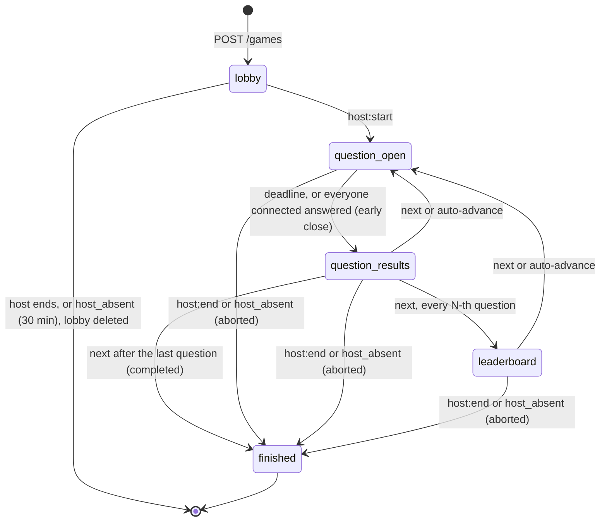

# Backend

NestJS 12 on Node 24, TypeScript, one instance. Live game state is in Redis, history and content in PostgreSQL, images in MinIO. REST is described in [Contracts](contracts.md); this page covers how the server is built and how a game runs.

## Modules

| Path (`apps/api/src`) | Responsibility |
| --- | --- |
| `config/` | zod validation of the environment (`loadConfig`) |
| `db/` | Drizzle schema, SQL migrations (applied on every start), connection pool |
| `redis/` | shared Redis client |
| `auth/` | email and password (argon2) registration and login, Redis-backed session cookie `qp_session`, CSRF (`qp_csrf` cookie and `X-CSRF-Token` header), `HostGuard` |
| `quizzes/` | host quizzes: CRUD, validation with the shared zod schema, snapshot of a quiz for a game |
| `packs/` | read-only built-in packs; `PackSeeder` upserts `seed/packs/*.json` by `packKey` on every start; copy into the host's studio |
| `images/` | upload to MinIO (type detected from the file signature, up to 5 MiB), public read by UUID |
| `games/` | everything live, see below |
| `common/` | `Clock`, `AppError`, per-key mutex, OpenAPI request validator, error filter |
| `health/` | `GET /healthz` |

`games/` in detail:

- `game.store.ts`: Redis persistence of the state, PIN and host slot, player tokens.
- `game.service.ts`: runs a command through the pure reducer, carries out the effects, broadcasts the result.
- `game.timers.ts`: BullMQ delayed jobs.
- `game.gateway.ts` and `presence.ts`: Socket.io namespace `/game`, rooms, who is online.
- `rate-limit.ts`: token bucket per socket (burst of 10, refill 5 per second).
- `games.controller.ts`, `history.service.ts`, `history.controller.ts`: `POST /games`, `GET /games/active`, history in PostgreSQL.

The rules themselves live outside Nest in `packages/game-engine` and are pure: `reduce(state, command, now)` returns the new state plus a list of effects (`schedule`, `persist_history`, `close_lobby`, `notify_kicked`) or an `ErrorCode`. `packages/protocol` holds the event names, views, error codes, limits (`limits.ts`) and zod schemas used by both sides.

## Request path of a socket event

1. Rate limit, then payload validation (zod), then role check (host session or bound player).
2. `GameService.execute(gameId, command)`: serialized per game inside the process by a keyed mutex.
3. `GameStore.update`: read the state, `reduce`, write back with `WATCH`/`MULTI` (optimistic compare-and-set, retried with jitter up to 10 times).
4. Effects are applied one by one; a failing effect is logged and does not stop the broadcast.
5. The new state is projected to a host view and a view per player and emitted to their rooms. Views never contain the correct answer of an open question.

The server clock is the only clock: answer time comes from the receipt of the event, never from the client.

## Game phases

Pause is not a phase but an overlay on `question_open`, `question_results` and `leaderboard` (`pause: null | { reason: 'host' | 'host_disconnected' }`). While paused the question deadline and auto-advance are frozen, answers are refused with `PAUSED`, and the question text is hidden from every view. The 30-minute `host_absent` timer keeps running during a pause by design: a host who paused and then left must not keep the game alive forever. If the host disconnects while the game is already paused by the host, the reason becomes `host_disconnected`, so players learn the host is gone; on reconnect it turns back to `host` and the game stays paused until the host resumes.

- Closing an open question scores it, adds points, and moves to `question_results`. Closing an open question by ending the game early drops its unscored answers (history shows only closed questions).
- A lobby that is ended is deleted, never reaches history, and clients get `game:closed`.
- `finished` carries an outcome: `completed` (after the last question) or `aborted` (host ended early or was away for 30 minutes).
- The answer time is the server time the `player:answer` event arrived (`receivedAt`, stamped by the gateway before rate limiting, validation and the per-game lock), not the time the command was processed, so queueing behind other commands costs neither points nor the deadline.
- An answer that arrived at or after the deadline is refused with `QUESTION_CLOSED` even if the timer job has not fired yet (`receivedAt >= closesAt`). An answer for a question already closed gets the same `QUESTION_CLOSED` in `question_results` and `leaderboard`, so a late tap yields one code whether or not the deadline timer has fired.
- Score: `round((1000 - 500 * t / T) * multiplier)` for a correct option, where `t` is active time (pauses excluded). Numeric questions use a tolerance and an accuracy factor that falls from 1 to 0.5; if nobody is within tolerance, the closest answers get 500 times the multiplier. Ties on the leaderboard are broken by the lower total time of correct answers.

## Redis keys

| Key | Type | Content | TTL |
| --- | --- | --- | --- |
| `game:{gameId}:state` | string (JSON) | the whole `GameState` | 24 h after the last change, 1 h once finished |
| `game:{gameId}:tokens` | hash | sha256(player token) to player id | same as the state |
| `pin:{pin}` | string | game id of the game that holds the PIN | 24 h, refreshed with the state, freed at finish |
| `host:{hostId}:active` | string | game id; at most one active game per host | same as the PIN |
| `qp:sess:{sid}` | string | host session | per session |
| `bull:game-timers:*` | BullMQ | delayed timer jobs | until fired |
| Socket.io adapter channels | pub/sub | cross-instance emits | none |

PIN and host-slot release use a compare-and-delete script, so a late release never frees the PIN or slot of a newer game. A PIN is six digits, unique among active games, and allocated with `SET NX`.

## Timers and epochs

Timers are BullMQ delayed jobs in queue `game-timers` with job id `{gameId}:{timer}:{epoch}`, so scheduling the same timer twice is a no-op, and they live in Redis, so they survive a restart. A job carries its due time; a job that wakes early is moved back to delayed. The worker processes up to 8 jobs at a time, so one game's slow history save does not delay another game's deadline; commands for one game still run one at a time behind the per-game lock. The state records when the pending `auto_advance` (`advanceAt`) and `host_absent` (`hostAbsentAt`) fire, so the pending timers can be re-derived from the state (`pendingTimers`).

| Timer | Epoch counter | Fires when |
| --- | --- | --- |
| `question_deadline` | `timerEpoch` | the question time runs out |
| `auto_advance` | `timerEpoch` | automatic mode: N seconds after results or leaderboard |
| `host_absent` | `hostEpoch` | 30 minutes after the host disconnected, or after a lobby was created |

Every state change that makes a pending timer obsolete increments the epoch (opening or closing a question, pause, resume, finish; for `hostEpoch` every host connection change). A fired timer carries the epoch it was scheduled with, and the reducer ignores it when it differs. That makes stale jobs harmless: no job has to be cancelled, and a timer for a deleted game is a no-op. The reducer additionally refuses to close a question before its `closesAt`.

## Connection state

The gateway keeps one Socket.io room per participant; a participant is online while at least one socket is in its room, so a second tab closing does not mark anybody offline. Presence changes are applied as commands (`host_connection`, `player_connection`) only on real transitions, because every `host_connection false` restarts the 30-minute window.

- Host offline: automatic pause (`host_disconnected`) and the `host_absent` timer. Reconnecting does not resume; the host presses resume.
- Player offline: shown grey on the host screen; early close counts only connected players. Players rejoin with the token they got on joining (`player:rejoin`), and a kicked player cannot.
- A game is created with the host marked offline and `host_absent` scheduled, so a host who never opens the game screen does not leave a lobby forever (30 minutes).
- A player token is issued before the join command, so a failure leaves no half-joined player.

## Restart recovery

The process can die at any moment; on start, `GameService.onApplicationBootstrap` runs before the server listens:

1. **Unsaved history.** Games that are `finished` in Redis (kept for an hour) and have no history row are persisted again. Persisting is idempotent. The PIN and host slot of every finished game are released, whether or not the row already existed.
2. **Presence reconciliation.** Nobody is connected right after a start, so in every running game the host goes offline first (the game pauses, `host_absent` starts), then every player who was marked online goes offline. The host goes first so that the remaining players having answered cannot close the question early. If asking for presence fails, the participant is treated as offline.
3. **Timers.** They are in Redis and keep firing; stale ones are ignored through epochs. In case a job was lost (for example a `schedule` effect that failed), the timer each running game waits for is scheduled again from its state: the deadline at `closesAt` for an open, unpaused question; `auto_advance` at `advanceAt`; `host_absent` at `hostAbsentAt` while the host is offline (or now plus 30 minutes for a state written before that field existed). A job that still exists keeps its id and is not added twice.

Clients come back through the usual flow: players `player:rejoin` with their token and are marked online; the host `host:join`s, finds the game paused with the remaining time of the question preserved, and resumes. One game failing to recover is logged and does not stop the others or the start.

Other effect failures: after a state change is committed, the broadcast is sent even if an effect failed; saving history is retried three times inline and, if it still fails, is picked up at the next start.

## Fairness rules enforced here

- One answer per player per question, no change; an answer for another question index, a closed question, or during pause is refused. The answer time is taken on receipt by the server.
- The correct answer, other players' choices and points are not in any view until the question is closed.
- Host commands need the session of the game's owner (`UNAUTHENTICATED`, `NOT_HOST`, `FORBIDDEN`).
- A player's nickname is trimmed, collapsed and unique ignoring case among players who were not kicked; up to 50 players.

## Known limits

- A `schedule` effect that fails is only logged; the timer is re-derived from the state at the next start (see above), not earlier.
- One instance. The per-game mutex is in-process; across processes the `WATCH`/`MULTI` guard still keeps the state consistent, but multi-instance operation is not tested.
- The session cookie sets `Secure` only with `COOKIE_SECURE=true`; `trust proxy` is not configured for TLS terminated in front of the API.
- Shutdown hooks are enabled, so `docker stop` closes connections cleanly.
